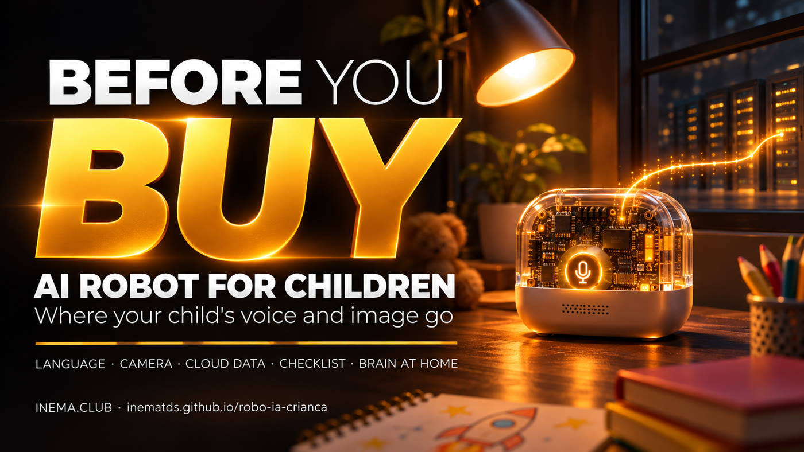

# AI Robot for Children: What You Need to Know Before Buying

**🇧🇷 [Português](README.md) · 🇺🇸 [English](README.en.md) · 🇪🇸 [Español](README.es.md)**

## What it is

This guide explains the inexpensive AI robots for children found on Brazilian marketplaces. They don’t have intelligence inside: they record your voice (and, in some models, images) and send them over the internet to AI services in China, which respond by voice. Here you’ll find the risks, a checklist to use before buying, precautions if you’ve already bought one, and an approach, still to be tested, for running the “brain” on your own computer. You don’t need to know anything about technology: just read.

## 📖 Guide

Complete guide (landing page + step-by-step): **https://inematds.github.io/robo-ia-crianca/guia/en/**

## What’s in the repository

| File | What it’s for |
|---|---|
| [`guia/`](guia/) | The guide in PT, EN, and ES (GitHub Pages) |
| [`docs/checklist.md`](docs/checklist.md) (in Portuguese) | Printable checklist: before buying and if you’ve already bought one |
| [`docs/cerebro-local.md`](docs/cerebro-local.md) (in Portuguese) | Technical guide **to be tested** for running the robot’s brain at home |
| [`capa/capa.png`](capa/capa.png) | INEMA catalog cover |

## The process, from start to finish

Who does what: 🧠 session with Nei · ⚙️ script/timer · 🤖 `claude -p`

1. 🧠 **Research** — listings for children’s AI robots on a Brazilian marketplace, public research on AI toys, and open projects (xiaozhi-esp32-server, OpenToys). Separate what is confirmed from what is likely.
2. ⚙️ **Cover and hero** — `node ~/.claude/skills/capa-inema/assets/gerar-capa.cjs --repo . --title "Robô de IA para criança" --cat "Segurança" --gerador auto --save-raw guia/assets/hero.png` (Codex image_gen; flux2-klein only if it fails).
3. ⚙️ **Banners** — `bash ~/.claude/skills/projetos-landing-guia/assets/gerar-banner.sh` in the `live` and `grade` styles, in PT, EN, and ES (6 images in `guia/assets/`). Check the text in each one.
4. 🧠 **PT guide** — `guia/index.html`, based on the `projetos-landing-guia` skill template.
5. ⚙️ **Translation** — `guia/en/` and `guia/es/` and the READMEs using the central translator: `cat pedido.txt | ~/projetos/wifi/scripts/inema-traduz`.
6. 🧠 **Docs** — `docs/checklist.md` and `docs/cerebro-local.md`.
7. 🤖 **Independent reviewer** — a new agent reads the guide using the skill’s fixed checklist.
8. 🧠 **Publish** — `git push`; GitHub Actions (`.github/workflows/pages.yml`) publishes the Pages site. Check `/guia/`, `/guia/en/`, `/guia/es/` return HTTP 200.
9. 🧠 **Test the brain at home** (pending) — buy a Bean Bun, open it, follow `docs/cerebro-local.md`, and update the guide and docs with the results.
10. 🧠 **Portal and Telegram** — handled by Nei, outside this repository.

## Notice

Educational content from INEMA. We don’t name seller brands or link to listings. The “brain at home” approach has not yet been tested by INEMA.

---
[INEMA.CLUB](https://inema.club)