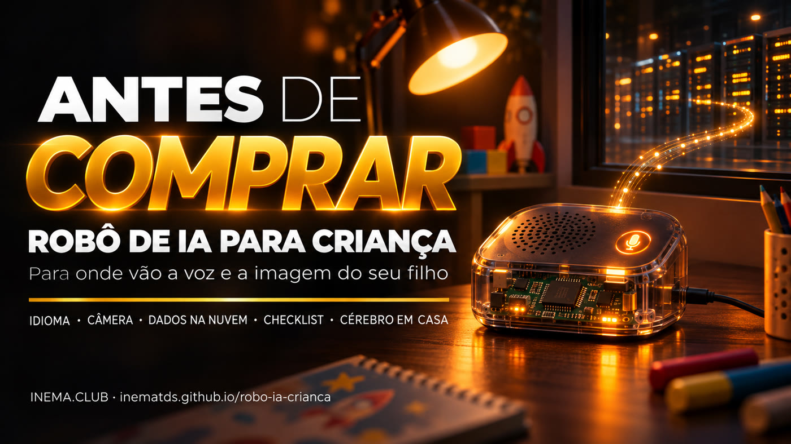

# Robot de IA para niños: qué necesitas saber antes de comprar

**🇧🇷 [Português](README.md) · 🇺🇸 [English](README.en.md) · 🇪🇸 [Español](README.es.md)**

## Qué es

Esta guía explica cómo son los robots de IA baratos para niños que aparecen en los marketplaces brasileños. No tienen inteligencia dentro: graban la voz (y, en algunos modelos, la imagen) y la envían por internet a servicios de IA en China, que responden con voz. Aquí encontrarás los riesgos, una lista de verificación para usar antes de comprar, los cuidados que debes tener si ya compraste uno, un **kit para educadores** (clase de 30 min con póster, actividad y nota), un **monitor de red** que muestra con quién se comunica el robot y cuánto envía, y una opción, todavía pendiente de probar, para ejecutar el «cerebro» en tu propia computadora. El **control parental** (historial, horarios, filtro y alerta) está en la [hoja de ruta](ROADMAP.es.md). No hace falta saber de tecnología: solo tienes que leer.

## 📖 Guía

Guía completa (página de presentación + paso a paso): **https://inematds.github.io/robo-ia-crianca/guia/es/**

🎬 Video: https://www.youtube.com/shorts/2td4u5iq3MU

## Qué hay en el repositorio

| Archivo | Para qué sirve |
|---|---|
| [`guia/`](guia/) | La guía en PT, EN y ES (GitHub Pages) |
| [`docs/checklist.md`](docs/checklist.md) | Lista de verificación para imprimir: antes de comprar y si ya compraste |
| [`docs/cerebro-local.md`](docs/cerebro-local.md) | Guía técnica **pendiente de probar** para ejecutar el cerebro del robot en casa |
| [`kit-educador/es/`](kit-educador/es/) | Clase de 30 min para niños de 6 a 12 años + [hojas para imprimir](https://inematds.github.io/robo-ia-crianca/kit-educador/es/imprimir.html) (PT/EN/ES) |
| [`vigia/`](vigia/) | Monitor de red: con quién se comunica el robot y cuánto envía (`./teste.sh` funciona sin robot) |
| [`ROADMAP.md`](ROADMAP.es.md) | Etapas y control parental planificado |
| [`capa/capa.png`](capa/capa.png) | Portada del catálogo de INEMA |

## El proceso, de principio a fin

Quién lo hace: 🧠 sesión con Nei · ⚙️ script/timer · 🤖 `claude -p`

1. 🧠 **Investigación** — anuncios de robots de IA para niños en un marketplace brasileño, investigaciones públicas sobre juguetes de IA y proyectos abiertos (xiaozhi-esp32-server, OpenToys). Separar lo confirmado de lo probable.
2. ⚙️ **Portada y hero** — `node ~/.claude/skills/capa-inema/assets/gerar-capa.cjs --repo . --title "Robô de IA para criança" --cat "Segurança" --gerador auto --save-raw guia/assets/hero.png` (Codex image_gen; flux2-klein solo si falla).
3. ⚙️ **Banners** — `bash ~/.claude/skills/projetos-landing-guia/assets/gerar-banner.sh` con los estilos `live` y `grade`, en PT, EN y ES (6 imágenes en `guia/assets/`). Revisar el texto de cada una.
4. 🧠 **Guía PT** — `guia/index.html`, a partir de la plantilla de la skill `projetos-landing-guia`.
5. ⚙️ **Traducción** — `guia/en/` y `guia/es/`, y los READMEs con el traductor central: `cat pedido.txt | ~/projetos/wifi/scripts/inema-traduz`.
6. 🧠 **Documentos** — `docs/checklist.md` y `docs/cerebro-local.md`.
7. 🤖 **Revisión independiente** — un agente nuevo lee la guía con la lista fija de la skill.
8. 🧠 **Publicación** — `git push`; GitHub Actions (`.github/workflows/pages.yml`) publica GitHub Pages. Comprobar que `/guia/`, `/guia/en/` y `/guia/es/` respondan con HTTP 200.
9. 🧠 **Kit para educadores** — `kit-educador/aula.md` + `kit-educador/imprimir.html` (póster, actividad y nota); EN/ES en `kit-educador/en/` y `es/` con el traductor central.
10. ⚙️ **Monitor de red** — `cd vigia && ./teste.sh` (7 pruebas con una captura inventada); en vivo: `./hotspot.sh --ligar` → `sudo python3 vigia_robo.py --iface <placa> --ip <robô>`.
11. 🧠 **Prueba del cerebro en casa** (pendiente) — comprar un Bean Bun, abrirlo, seguir `docs/cerebro-local.md` y actualizar la guía y los documentos con el resultado.
12. 🧠 **Control parental** (planificado) — consultar [`ROADMAP.md`](ROADMAP.es.md); depende del paso 11.
13. 🧠 **Portal y Telegram** — se hacen fuera de este repositorio (portal inema.club, tema INEMA.ROBOT).

## Aviso

Contenido educativo de INEMA. No mencionamos marcas de vendedores ni enlaces a anuncios. INEMA todavía no ha probado la opción del «cerebro en casa».

---
[INEMA.CLUB](https://inema.club)
