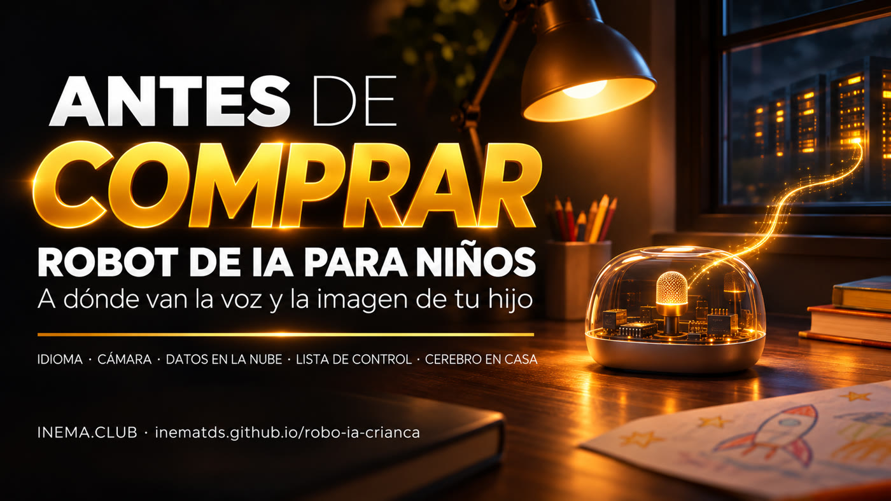

# Robot de IA para niños: lo que debes saber antes de comprar

**🇧🇷 [Português](README.md) · 🇺🇸 [English](README.en.md) · 🇪🇸 [Español](README.es.md)**

## Qué es

Esta guía explica cómo son los robots de IA baratos para niños que aparecen en los marketplaces brasileños. No tienen inteligencia propia: graban la voz (y, en algunos modelos, la imagen) y la envían por internet a servicios de IA en China, que responden con voz. Aquí encontrarás los riesgos, una checklist para consultar antes de comprar, los cuidados que debes tener si ya compraste uno y una alternativa, todavía pendiente de probar, para que el «cerebro» funcione en tu propia computadora. No necesitas saber nada de tecnología: solo tienes que leer.

## 📖 Guía

Guía completa (landing + paso a paso): **https://inematds.github.io/robo-ia-crianca/guia/es/**

## Qué hay en el repositorio

| Archivo | Para qué sirve |
|---|---|
| [`guia/`](guia/) | La guía en PT, EN y ES (GitHub Pages) |
| [`docs/checklist.md`](docs/checklist.md) (en portugués) | Checklist para imprimir: antes de comprar y si ya compraste uno |
| [`docs/cerebro-local.md`](docs/cerebro-local.md) (en portugués) | Guía técnica **pendiente de probar** para hacer funcionar el cerebro del robot en casa |
| [`capa/capa.png`](capa/capa.png) | Portada del catálogo INEMA |

## El proceso, de principio a fin

Quién lo hace: 🧠 sesión con Nei · ⚙️ script/timer · 🤖 `claude -p`

1. 🧠 **Investigación** — anuncios de robots de IA para niños en un marketplace brasileño, investigaciones públicas sobre juguetes de IA y proyectos abiertos (xiaozhi-esp32-server, OpenToys). Distinguir lo confirmado de lo probable.
2. ⚙️ **Portada y hero** — `node ~/.claude/skills/capa-inema/assets/gerar-capa.cjs --repo . --title "Robô de IA para criança" --cat "Segurança" --gerador auto --save-raw guia/assets/hero.png` (Codex image_gen; flux2-klein solo si falla).
3. ⚙️ **Banners** — `bash ~/.claude/skills/projetos-landing-guia/assets/gerar-banner.sh` en los estilos `live` y `grade`, en PT, EN y ES (6 imágenes en `guia/assets/`). Revisar el texto de cada uno.
4. 🧠 **Guía PT** — `guia/index.html`, a partir de la plantilla de la skill `projetos-landing-guia`.
5. ⚙️ **Traducción** — `guia/en/` y `guia/es/` y los READMEs mediante el traductor central: `cat pedido.txt | ~/projetos/wifi/scripts/inema-traduz`.
6. 🧠 **Documentación** — `docs/checklist.md` y `docs/cerebro-local.md`.
7. 🤖 **Revisor independiente** — un agente nuevo lee la guía con la lista fija de la skill.
8. 🧠 **Publicar** — `git push`; GitHub Actions (`.github/workflows/pages.yml`) publica Pages. Comprobar `/guia/`, `/guia/en/`, `/guia/es/` con HTTP 200.
9. 🧠 **Prueba del cerebro en casa** (pendiente) — comprar un Bean Bun, abrirlo, seguir `docs/cerebro-local.md` y actualizar la guía + la documentación con el resultado.
10. 🧠 **Portal y Telegram** — a cargo de Nei, fuera de este repositorio.

## Aviso

Contenido educativo de INEMA. No mencionamos marcas de vendedores ni enlaces a anuncios. INEMA todavía no ha probado la alternativa de «cerebro en casa».

---
[INEMA.CLUB](https://inema.club)